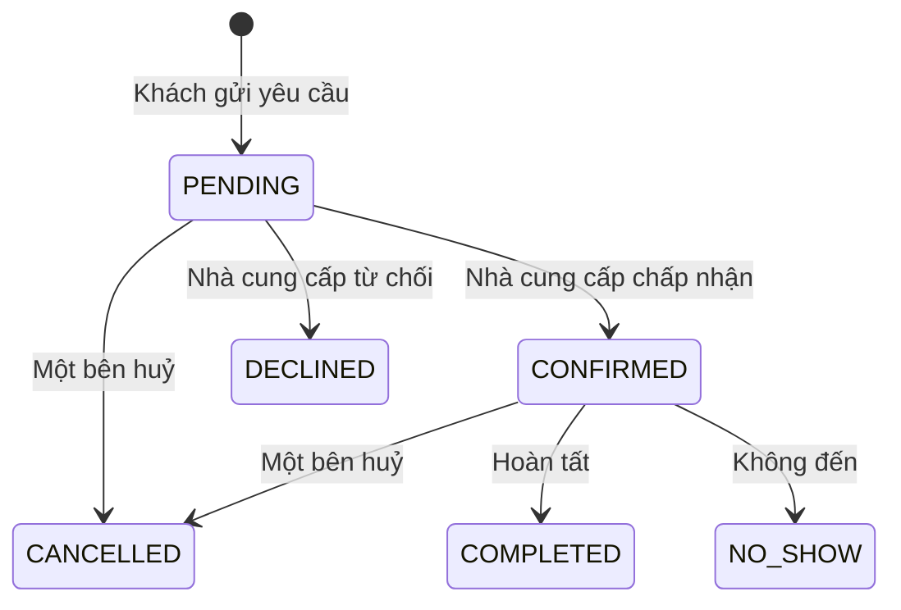

# Các tính năng của Fgrapher

Tài liệu này mô tả hành vi hiện tại ở mức sản phẩm. Code và feature flag mới là
nguồn quyết định cuối cùng; các guide Phase trong `docs/guides` chỉ là kế hoạch
lịch sử lúc xây dựng.

## 1. Công tắc tính năng

Các giá trị nằm trong `src/lib/env.ts`, được gom tại `src/lib/features.ts`.

| Công tắc                      | Mặc định      | Ý nghĩa                                                           |
| ----------------------------- | ------------- | ----------------------------------------------------------------- |
| `BILLING_ENABLED`             | Tắt           | Thanh toán subscription bằng Stripe                               |
| `FREE_ROLE_GRANT_ENABLED`     | Bật           | Cấp gói miễn phí cho vai trò mới khi chưa thu phí                 |
| `MARKETPLACE_ENABLED`         | Tắt           | Shop, sản phẩm, giỏ hàng và đơn hàng                              |
| `SOCIAL_FEED_ENABLED`         | Tắt           | Follow, post, like và comment                                     |
| `PHONE_VERIFICATION_REQUIRED` | Theo cấu hình | Bắt xác minh SMS trước khi đăng yêu cầu dịch vụ                   |
| `MOMO_ENABLED`                | Tắt           | Thanh toán subscription bằng MoMo                                 |
| `ZALOPAY_ENABLED`             | Tắt           | Thanh toán subscription bằng ZaloPay                              |
| `BANK_TRANSFER_ENABLED`       | Tắt           | Thanh toán chuyển khoản và admin xác nhận                         |
| `CONTENT_MODERATION_ENABLED`  | Tắt           | Máy quét ảnh tự động trước hàng chờ người duyệt                   |
| `VERCEL_ANALYTICS_ENABLED`    | Tắt           | Đếm lượt xem trang (Vercel), chỉ với khách đồng ý cookie thống kê |

`VERCEL_ANALYTICS_ENABLED` gửi dữ liệu lượt xem sang Vercel (ngoài Việt Nam), một
mục đích mà thông báo cookie và `/privacy` chưa nêu. Trước khi bật: sửa hai chỗ đó,
tăng `CURRENT_POLICY_VERSION` để hỏi lại người dùng, có xác nhận của luật sư, rồi bật
Analytics cho project trong Vercel (checklist việc 13).

Khi flag tắt, server phải chặn API hoặc không trả dữ liệu liên quan. Chỉ ẩn giao
diện không đủ bảo vệ.

## 2. Tài khoản và đăng nhập

Người dùng có thể:

- đăng ký bằng email/mật khẩu;
- xác minh email bằng link dùng một lần;
- đăng nhập Google OAuth;
- yêu cầu đặt lại mật khẩu;
- đổi email credential và xác minh địa chỉ mới;
- đăng xuất và quản lý thiết lập tài khoản.

Mật khẩu được hash bằng bcrypt. Token xác minh/reset có thời hạn, dùng một lần và
được lưu dạng hash khi luồng hỗ trợ. API gửi lại link không tiết lộ email có tồn tại
hay không.

Một tài khoản có thể có nhiều vai trò:

- Customer;
- Photographer;
- Videographer;
- Make-up Artist;
- Model;
- Studio;
- Camera Shop;
- Admin.

Admin không thể tự chọn khi đăng ký. Quyền admin được cấp bằng quy trình riêng.

## 3. Vai trò, gói và quyền truy cập

`UserRole` cho biết tài khoản đang có vai trò nào. Mỗi vai trò cung cấp dịch vụ có
thể có một `Profile` và trạng thái gói riêng. Tắt hoặc hết hạn một vai trò không
được làm hỏng các vai trò khác của cùng tài khoản.

Khi chưa thu phí, `FREE_ROLE_GRANT_ENABLED` cho phép cấp gói miễn phí. Admin có thể
gán hoặc gia hạn thủ công. Các cổng thanh toán chỉ được dùng khi flag, credential,
webhook và quy trình đối soát đều sẵn sàng.

Quyền phải được kiểm tra ở server bằng session, vai trò đang hoạt động, trạng thái
gói và feature flag. UI chỉ phản ánh kết quả kiểm tra đó.

## 4. Hồ sơ công khai

Mỗi hồ sơ thuộc một vai trò và có thể chứa:

- tên hiển thị, mô tả, ảnh đại diện/ảnh bìa;
- địa điểm và vùng phục vụ;
- loại dịch vụ, khoảng giá và thông tin liên hệ được phép công khai;
- portfolio theo album;
- dịch vụ có thể đặt;
- rating và đánh giá;
- trường riêng của từng vai trò;
- thông tin tự khai (từ 09/2026): số năm kinh nghiệm, % đặt cọc và chính sách
  đặt cọc, chính sách hủy lịch, chính sách đổi lịch, bán kính phục vụ (km).
  Tất cả không bắt buộc; bỏ trống thì hồ sơ không hiện dòng đó. Đặt cọc chỉ là
  thông tin cho khách — tiền trao trực tiếp với nghệ sĩ, nền tảng không thu.

Số buổi đã chụp và thời gian phản hồi **không** lưu mà tính từ booking và tin
nhắn khi hiển thị.

Hồ sơ chỉ xuất hiện công khai khi đáp ứng quy tắc publish hiện hành, gồm trạng thái
vai trò/gói, xác minh cần thiết và media đã được duyệt. Service ở server phải lọc
lại; không dựa vào component ẩn.

Người xem có thể chia sẻ URL hoặc tạo mã QR trỏ tới hồ sơ.

## 5. Portfolio, album và media

Nhà cung cấp quản lý media theo album:

- tạo/sửa/xoá album;
- upload ảnh/video qua signed upload Cloudinary;
- cắt ảnh và kéo thả đổi thứ tự;
- chọn ảnh bìa;
- xác nhận có quyền sử dụng nội dung;
- đưa album/media vào thùng rác và khôi phục trong thời hạn;
- cron xoá vĩnh viễn media hết hạn khỏi database và Cloudinary.

Mỗi upload có trạng thái kiểm duyệt. Chỉ media `APPROVED` được trả cho trang công
khai. Chủ hồ sơ vẫn thấy trạng thái pending/rejected để sửa.

Trên trang hồ sơ công khai, khung "Tất cả ảnh" mở ra với 9 ảnh; nút "Xem thêm ·
còn N ảnh" mở thêm 9 ảnh mỗi lần, để khách không phải cuộn qua cả portfolio mới
tới phần đánh giá và thông tin bên dưới. Đổi bộ lọc phong cách thì quay về 9 ảnh;
trình xem ảnh vẫn lướt được qua mọi ảnh và tự mở thêm khung phía sau cho khớp.

Khi bộ quét tự động bật, nó chỉ phân loại/rút ngắn hàng chờ. Người kiểm duyệt mới
quyết định xử lý tài khoản. Ảnh giấy tờ KYC không được gửi qua luồng quét portfolio.

## 6. Tìm kiếm và khám phá

Trang `/browse` hỗ trợ các bộ lọc như vai trò, từ khoá, địa điểm, giá, category và
rating. Kết quả chỉ gồm hồ sơ được phép công khai. Một tài khoản nhiều vai trò được
gom thành card phù hợp thay vì lặp vô ích.

Giao diện tìm kiếm:

- debounce ô từ khoá;
- cập nhật filter có kiểm soát để click nhanh không ghi đè nhau;
- có loading/empty state;
- phân trang hoặc giới hạn kết quả;
- dùng thumbnail và chỉ tải ảnh cần hiển thị.

Dữ liệu địa lý lấy từ bảng Province/Ward, không hardcode danh sách tỉnh thành trong
component.

Từ 09/2026:

- **Ngày & giờ cần chụp** (`date`, `from`, `to` trên URL): chỉ hiện nghệ sĩ còn
  trống vào ngày/khung giờ đó, cùng một quy tắc với Bản đồ F
  (`providersAvailableForInterval` trong `services/fmap.ts`). Không chọn giờ thì
  chỉ cần còn ít nhất một giờ trống trong ngày. Mỗi thẻ ghi "Còn lịch dd/MM/yyyy".
- **Tab Album dự án** (`tab=albums`): album đã xuất bản có ít nhất một ảnh được
  duyệt, lọc theo cùng bộ lọc của tab Nghệ sĩ (`searchAlbums`). Bấm album mở ảnh
  ngay tại chỗ trong lightbox (trước/sau, nút sang trang cá nhân và "Đặt lịch"),
  không rời trang (`AlbumQuickView`, đọc qua `GET /api/albums/[id]/public`). Mở
  tab mới (Ctrl/Cmd + bấm) vẫn tới trang album. Cộng đồng F làm giống vậy với bài
  album và mục album nổi bật (16/11/2026).
- Lưới ảnh (hồ sơ, tab Theo ảnh) chỉ còn "Bố cục gốc"; chế độ Contact sheet đã bỏ
  (16/11/2026).
- Chip cho từng bộ lọc đang bật (bỏ riêng từng cái) và "Xóa tất cả" (giữ từ khoá).

**Fmap** (`/fmap`) là cách tìm thứ hai, trên bản đồ: khách chọn khu vực (GPS, tỉnh/thành
hoặc kéo bản đồ), một hoặc nhiều ngày (tối đa 7, lịch tháng `MultiDateCalendar`), giờ,
vai trò và thể loại, và chỉ thấy provider **đang rảnh** vào khung giờ đó ở **ít nhất
một** ngày đã chọn; "Đặt lịch" mở sẵn ngày rảnh đầu tiên của provider đó. Marker là một khung ảnh — ảnh portfolio mới nhất đã duyệt — kèm giá
khởi điểm viết gọn ("2,0tr"); bấm vào mở thẻ xem nhanh có dải 3 ảnh gần nhất, nút "Xem
hồ sơ" và "Đặt lịch" (trang đặt lịch nhận sẵn ngày giờ đã chọn). "Tìm khi di chuyển bản
đồ" (bật mặc định) tự tìm lại khi thôi kéo bản đồ. Vị trí
provider mặc định được làm mờ. Chi tiết: `docs/ops/fmap.md`.

### Địa điểm chụp (20/11/2026)

Địa điểm chụp đẹp trên Bản đồ F, vừa là cẩm nang vừa dẫn khách tới người chụp ở đó
(chủ dự án chọn hai mục tiêu ngang nhau). Bảng `Place` + `PlaceMedia`, thêm
`Album.placeId`; logic ở `services/places.ts`.

- **Ai thêm.** Nhà cung cấp đã xác minh danh tính (mọi vai trò trong
  `PROVIDER_ROLES`) và admin. Đề xuất ở "Tiện ích khác → Địa điểm chụp"
  (`/dashboard/places`): thả ghim trên bản đồ, tên, loại, kiểu chụp hợp, mô tả,
  tỉnh/phường, giờ đẹp, tháng đẹp, vé vào cổng, phí chụp, cần xin phép không, quy
  định, lúc đông, gửi xe, 1–10 ảnh tự chụp (bắt buộc tick xác nhận quyền với ảnh).
  Tối đa 5 đề xuất chờ duyệt một lúc. Ghim cách địa điểm có sẵn dưới 200 m bị hỏi
  "có phải địa điểm này?" trước khi gửi. Thả ghim thì tỉnh/phường tự điền theo vị
  trí (tra ngược qua MapTiler/Goong, `/api/places/area`); chọn tỉnh khác chỗ ghim
  thì form cảnh báo và có nút chuyển. Bản đồ trong form dùng hai ngón để kéo (một
  ngón cuộn trang).
- **Duyệt.** Không gì hiện công khai trước khi admin duyệt (`/admin/places`). Duyệt
  địa điểm thì duyệt luôn ảnh còn chờ; admin từ chối ảnh xấu trước, từng ảnh. Từ
  chối cần lý do; người đề xuất sửa và gửi lại. Admin còn: sửa mọi thông tin, đổi
  tình trạng (đang mở / tạm đóng / cấm chụp, kèm ghi chú), đánh dấu "đã kiểm tra
  hôm nay", thêm ảnh, chọn ảnh bìa, gộp địa điểm trùng (album và ảnh chuyển sang,
  địa chỉ cũ chuyển hướng 308), xoá. Mọi thao tác ghi `AdminAction`. Người đề xuất
  nhận thông báo `PLACE_APPROVED`/`PLACE_REJECTED`. Trang quản lý (21/11/2026):
  tab có số đếm — Chờ duyệt, **Cần xem lại** (địa điểm công khai có báo cáo của
  khách hoặc đang đóng/cấm chụp), Đã duyệt, Đã từ chối — lọc theo tỉnh; trang
  duyệt đặt quyết định và danh sách cần kiểm lên đầu, rồi báo cáo của khách, tóm
  tắt kèm bản đồ + Google Maps, ảnh, và form sửa thu gọn. Tổng quan admin có ô
  "Địa điểm chụp chờ duyệt".
- **Trang công khai.** `/dia-diem` (theo tỉnh, lọc theo loại), `/dia-diem/<tỉnh>`,
  `/dia-diem/<tỉnh>/<slug>`: ảnh bìa lớn rồi các ảnh khác, bản đồ nhỏ, thông tin
  thực tế (mục chưa biết gom thành một dòng "Chưa có thông tin về: …", không đoán),
  chỉ đường, "Nhiếp ảnh gia đã chụp ở đây" (album gắn địa điểm, kèm nút Đặt lịch /
  Nhắn tin),
  "Nhà cung cấp ở gần" (trong 15 km, không ghi khoảng cách tới địa chỉ riêng của
  họ), "Báo thông tin sai" (lý do riêng cho địa điểm). Chưa có địa điểm công khai
  nào thì các trang này là 404 và không có trong sitemap — tức tính năng tự ẩn tới
  khi admin duyệt địa điểm đầu tiên. JSON-LD `TouristAttraction` + `BreadcrumbList`.
- **Lối vào.** Menu chung có "Địa điểm chụp"; trang chủ có khối "Địa điểm chụp
  đẹp" (3 địa điểm) — cả hai chỉ hiện khi đã có địa điểm công khai.
- **Bản đồ F.** Nút "Địa điểm chụp" (góc dưới trái) bật lớp chấm vàng, tải theo
  vùng đang xem ("Đang tải…" trong lúc chờ); mỗi chấm là một nút nằm trên ảnh nhà
  cung cấp; bấm chấm mở thẻ xem nhanh và đưa chấm lên phần bản đồ còn thấy. `/fmap?layer=places&lat=&lng=&place=`
  mở sẵn lớp và địa điểm (nút "Xem trên Bản đồ F" ở trang địa điểm).
- **Album "Chụp tại".** Ô tìm địa điểm (gõ không dấu được) khi tạo album và trên
  trang album; chỉ chọn được địa điểm đã duyệt. Trang album ghi "Chụp tại …" (link
  sang địa điểm); hồ sơ nhiếp ảnh gia ghi nơi chụp trên từng album và danh sách
  "Địa điểm đã chụp"; "Trang của tôi" có thẻ đếm album đã gắn địa điểm.
- **Xoá tài khoản / xuất dữ liệu.** Xuất dữ liệu có địa điểm đã đề xuất và ảnh địa
  điểm. Xoá tài khoản: ảnh họ tải lên rời trang địa điểm, đề xuất chưa duyệt bị
  xoá, địa điểm đã duyệt ở lại nhưng không còn gắn với họ.
- **Dữ liệu khởi đầu.** Gợi ý 50 địa điểm cần người thật kiểm chứng:
  `docs/ops/dia-diem-khoi-dau.md`.

## 7. Dịch vụ và lịch rảnh

Nhà cung cấp có thể tạo dịch vụ với tên, mô tả, mức giữ lịch và giá, và (từ 09/2026)
số ảnh chỉnh sửa giao kèm và số ngày giao ảnh.

**Mức giữ lịch (25/11/2026).** Mỗi gói chọn một trong ba mức: 1 giờ, nửa ngày
(4 giờ), cả ngày (8 giờ) — `SERVICE_HOLD_MINUTES` trong
`src/lib/constants/service-matrix.ts`, lưu vào `Service.duration` (phút). Một
lịch đặt giữ lịch của nhà cung cấp đúng khoảng đó kể từ giờ khách chọn. Quyết
định này thay cho quyết định 21/09/2026 (ẩn hẳn ô thời lượng, mọi gói giữ 1
giờ). Gói có thời lượng khác từ trước được làm tròn lên mức gần nhất khi mở
form sửa. Gói dài hơn giờ làm việc trong ngày vẫn có một khung giờ: đầu giờ làm
việc.

Availability kết hợp:

- lịch làm việc thường lệ;
- ngày bị chặn;
- booking đang giữ chỗ;
- buổi làm việc provider tự ghi (`CalendarEntry`, xem "Lịch làm việc" bên dưới);
- thời gian báo trước;
- múi giờ và ngày người dùng chọn.

Server phải kiểm tra lại availability ngay trước khi tạo booking để hai khách không
giành cùng một khung giờ.

### Bảng điều khiển theo vai trò (20/11/2026)

Quyết định của chủ dự án: bảng điều khiển của nhà cung cấp chỉ bày những việc
của nghề; các chức năng phụ gom vào một chỗ khác. Một mô hình duy nhất
(`src/lib/dashboard-nav.ts`, có unit test) quyết định menu máy tính, thanh tab
điện thoại và bảng "Thêm".

| Vai trò                                          | Menu chính                                                                                          | Thanh tab điện thoại                            |
| ------------------------------------------------ | --------------------------------------------------------------------------------------------------- | ----------------------------------------------- |
| Nhiếp ảnh, quay phim, make-up, studio, người mẫu | Hôm nay · Lịch làm việc · Lịch đặt · Tin nhắn · Tìm việc · Trang của tôi                            | Hôm nay · Lịch · Tin nhắn · Hồ sơ · Thêm        |
| Cửa hàng máy ảnh                                 | Hôm nay · Cửa hàng · Tin nhắn · Trang của tôi                                                       | Hôm nay · Cửa hàng · Tin nhắn · Hồ sơ · Thêm    |
| Tiệm trang phục                                  | Hôm nay · Tin nhắn · Trang của tôi                                                                  | Hôm nay · Tin nhắn · Hồ sơ · Thêm               |
| Khách hàng                                       | Tổng quan · Lịch đặt của tôi · Tin nhắn · Yêu cầu · Đăng yêu cầu · Đã lưu · Bảng ý tưởng · Đơn hàng | Tổng quan · Lịch đặt · Tin nhắn · Đã lưu · Thêm |

Sau menu chính luôn có **Tiện ích khác** (trừ khách hàng) và **Cài đặt**.

- **Trang của tôi** (`/dashboard/my-page`): mỗi phần khách nhìn thấy là một thẻ
  ghi rõ "Xong / Còn thiếu / Đang chờ" và thiếu gì (`services/my-page.ts`);
  đầu trang nói trang đã hiển thị với khách chưa và còn thiếu điều kiện nào
  (khớp với `setProfilePublished`). Các trang con có thanh tab chung: Tổng quan
  · Portfolio · Gói dịch vụ · Thông tin · Đánh giá · Link & QR.
- **Thông tin** (`/dashboard/my-page/info`): ảnh, tên đường dẫn, giới thiệu,
  khu vực, chính sách, liên kết — trước đây là mục "Hồ sơ theo vai trò" trong
  Cài đặt → Hồ sơ. Có mốc `#anh`, `#gioi-thieu`, `#khu-vuc`, `#chinh-sach`,
  `#lien-ket`, `#costumes`.
- **Gói dịch vụ** có trang riêng (`/dashboard/services`); **giờ nhận khách** là
  một bảng trong trang Lịch (`/dashboard/calendar?hours=1`).
- **Tìm việc** gộp "Yêu cầu phù hợp" và "Đề nghị đã gửi" bằng hai tab.
- **Tiện ích khác** (`/dashboard/more`): Chợ F (tin đăng, đơn bán, đơn mua),
  thuê dịch vụ (lịch đặt mình đã gửi — `/dashboard/bookings?side=sent`, đăng
  yêu cầu, yêu cầu của tôi), đã lưu, bảng ý tưởng, thông báo.
- **Cài đặt** với người có vai trò nhà cung cấp/cửa hàng chỉ còn Tài khoản, Vai
  trò, Thanh toán, Thông báo, Dữ liệu. Đường dẫn cũ `/dashboard/settings/profile`
  (kể cả `?section=roleProfile|availability`) tự chuyển sang chỗ mới, nên link
  trong email/thông báo cũ vẫn đúng. Khách hàng vẫn có tab Hồ sơ.
- **Điện thoại**: thanh tab cố định dưới đáy thay cho nút "Menu bảng điều
  khiển". Thứ gì cố định ở đáy màn hình (thông báo nổi, nút nổi của trang) cộng
  thêm `--fg-bottom-bar` để không bị thanh tab che.

### Lịch làm việc của provider (20/11/2026)

Trang `/dashboard/calendar` là sổ lịch của provider, không chỉ là nơi chặn ngày:

- **Một danh sách cho cả ngày.** Lịch đặt Fgrapher, buổi tự ghi và giờ bận được gom
  thành một danh sách theo thứ tự giờ (`getWorkAgenda`, `lib/calendar/agenda.ts`).
  Trang lịch, bản tóm tắt nhắc lịch và nguồn lịch cho điện thoại đều đọc cùng một
  hàm này nên không thể lệch nhau.
- **Buổi tự ghi (`CalendarEntry`).** Việc provider nhận ngoài Fgrapher: tên việc,
  ngày, giờ bắt đầu/kết thúc, địa điểm, tên và số điện thoại khách, giá đã thỏa
  thuận, ghi chú. Chỉ chủ lịch đọc và sửa được. Giờ đã ghi tự đóng trên hồ sơ công
  khai: hai bộ tính giờ trống (`services/availability.ts`, `services/fmap.ts`) đọc
  thẳng các dòng này, chỉ lấy khung giờ, không lấy thông tin khách. Buổi tự ghi được
  phép trùng giờ với việc khác (đó là sổ của provider); thẻ việc hiện cảnh báo
  "Trùng giờ".
- **Ghi chú riêng trên lịch đặt (`BookingNote`).** Mỗi bên giữ một ghi chú của riêng
  mình trên một lịch đặt. Là bảng riêng chứ không phải cột của `Booking`, để không
  truy vấn lịch đặt nào vô tình trả ghi chú cho bên kia.
- **Dữ liệu của người ngoài.** Tên và số điện thoại trong buổi tự ghi thuộc về người
  không dùng Fgrapher. Vì vậy buổi tự ghi bị xoá hẳn khi provider xoá (ngoại lệ của
  quy ước xoá mềm), nằm trong "tải dữ liệu của tôi" và bị xoá khi xoá tài khoản.
  Phần pháp lý của việc lưu này **chưa được luật sư xem** (xem checklist).
- **Giao diện.** Điện thoại: dải 7 ngày vuốt ngang, thẻ việc lớn có nút Gọi và Chỉ
  đường, nút "Thêm lịch" nổi, các bảng trượt lên từ đáy màn hình. Màn hình rộng: lưới
  tháng bên trái, việc của ngày đang chọn bên phải.
- **Nhắc lịch.** Tóm tắt tối hôm trước và sáng trong ngày; đồng bộ sang lịch điện
  thoại. Chi tiết vận hành ở `docs/OPERATIONS.md`.

Không có lịch làm việc thường lệ thì nhà cung cấp không bao giờ rảnh: không hiện trên
Bản đồ F, không qua được bộ lọc ngày của /browse và không có khung giờ để đặt. Vì vậy
(16/11/2026):

- lần đầu lưu hồ sơ nhà cung cấp, hệ thống đặt sẵn 08:00–20:00 mỗi ngày
  (`ensureDefaultWeeklyHours`, `DEFAULT_WEEKLY_HOURS` trong
  `services/resource-calendar.ts`); ai đã có giờ thì không bị đụng tới;
- migration `20261116120000_default_provider_weekly_hours` bổ sung cùng tuần đó cho
  nhà cung cấp cũ chưa có giờ nào (có hướng dẫn hoàn tác trong file);
- bảng điều khiển của nhà cung cấp hiện khối "Khách chưa tìm thấy bạn" khi chưa có
  giờ làm việc đang bật hoặc địa chỉ chưa có vị trí trên bản đồ, kèm nút tới đúng chỗ
  cần sửa.

## 8. Đặt lịch

Luồng cơ bản:

Hệ thống hỗ trợ đề xuất đổi lịch và bên còn lại chấp nhận/từ chối. Các chuyển trạng
thái phải tuân state machine; request lặp hoặc đến muộn không được đưa booking từ
trạng thái cuối quay lại trạng thái đang hoạt động.

Booking tạo hội thoại/liên kết để hai bên trao đổi. Cron gửi nhắc lịch và có cờ
chống gửi lặp.

Giao diện gửi yêu cầu (từ 09/2026) có 6 bước: Gói (hoặc "Tùy chỉnh" để nghệ sĩ báo
giá), Ngày, Giờ (có gợi ý **giờ vàng** gần lúc mặt trời mọc/lặn, tính trên trình
duyệt từ toạ độ đã làm tròn ~10 km của nghệ sĩ — `lib/sun.ts`), Địa điểm, Ghi chú,
Xem lại. Cột tóm tắt bên cạnh có nút "Sửa" cho từng dòng. "Lưu nháp & thoát" giữ
bản nháp trên thiết bị 7 ngày, không lưu số điện thoại. Dữ liệu gửi lên
`POST /api/bookings` không đổi.

## 9. Yêu cầu dịch vụ và đề nghị

Customer có thể đăng nhu cầu để nhà cung cấp chủ động gửi đề nghị:

1. Chọn vai trò/chuyên môn cần tìm.
2. Nhập thời gian, khu vực, ngân sách và mô tả.
3. Có thể lưu nháp rồi đăng.
4. Nhà cung cấp phù hợp xem cơ hội và gửi offer.
5. Customer nhắn tin, chấp nhận hoặc từ chối.
6. Offer được chấp nhận tạo booking; các offer pending khác bị từ chối.

Địa chỉ chi tiết được giữ lại tới khi cần. Giới hạn yêu cầu mở, xác minh điện thoại
và rate limit giúp giảm spam/chi phí SMS.

## 10. Tin nhắn

Người dùng có danh sách hội thoại, tin nhắn, số chưa đọc và `lastReadAt`. Chat
hiện dùng polling, không dùng Socket.io/WebSocket. Hook dùng chung phải:

- không tạo request chồng nhau;
- dừng khi tab ẩn;
- cập nhật ngay khi tab hoạt động lại;
- huỷ/loại bỏ kết quả cũ khi component đổi hội thoại hoặc unmount.

Tin nhắn có thể chứa liên kết booking hoặc ngữ cảnh nghiệp vụ. API luôn kiểm tra
người gọi có thuộc hội thoại.

## 11. Đánh giá

Đánh giá gắn với booking đủ điều kiện, nhờ vậy giảm review giả. Hệ thống hỗ trợ:

- rating sao và nội dung;
- một review theo quy tắc của booking;
- phản hồi của nhà cung cấp;
- tổng hợp rating/count;
- báo cáo và kiểm duyệt nội dung vi phạm.

Rating tổng hợp phải được tính từ dữ liệu thật, tránh cập nhật lệch giữa nhiều nơi.

## 12. Thông báo và email

Hai kênh chính:

- notification trong ứng dụng;
- email qua Resend/outbox.

Policy xác định loại nào bắt buộc, loại nào theo preference và loại nào phụ thuộc
feature flag. Email có idempotency key, retry/backoff và không để lỗi gửi mail làm
rollback nghiệp vụ đã thành công. Xem `docs/ops/notification-matrix.md` và
`docs/ops/email-outbox.md`.

## 13. Marketplace và social feed

Code sản phẩm, giỏ hàng, đơn hàng, follow/post/like/comment vẫn tồn tại nhưng mặc
định ngoài phạm vi MVP. Khi flag tắt:

- link điều hướng và vai trò liên quan được ẩn;
- route trang trả trạng thái phù hợp;
- API từ chối;
- dữ liệu không đi vào count, dashboard hoặc thông báo.

Không bật lại chỉ vì code build được. Cần kiểm tra thanh toán, hoàn tiền, giao hàng,
kiểm duyệt, điều khoản và vận hành thực tế.

## 14. Thanh toán

Fgrapher có hạ tầng cho Stripe và các phương thức Việt Nam nhưng tất cả phụ thuộc
quyết định kinh doanh/feature flag.

Nguyên tắc:

- trình duyệt không tự xác nhận thanh toán thành công;
- server xác minh chữ ký webhook/IPN;
- event có idempotency key;
- payment intent có thời hạn và state machine;
- số tiền/gói lấy từ cấu hình server;
- lỗi hoặc event lặp không được cấp quyền hai lần;
- admin action và đối soát phải để lại audit trail.

## 15. Quản trị

Admin có các khu vực cho:

- số liệu tổng quan;
- người dùng, vai trò, gói và trạng thái tài khoản;
- xác minh danh tính/KYC;
- kiểm duyệt media và báo cáo vi phạm;
- yêu cầu dữ liệu/xoá tài khoản;
- thanh toán thủ công;
- role change request;
- duyệt địa điểm chụp (`/admin/places`, xem "Địa điểm chụp" ở mục 6);
- audit log.

Mọi thao tác nhạy cảm phải gọi `requireAdmin()`, ghi `AdminAction` và không trả
password hash, token hoặc ảnh KYC ngoài endpoint chuyên dụng.

## 16. Quyền riêng tư và tuân thủ

Hệ thống có hạ tầng cho:

- consent theo từng mục đích và phiên bản chính sách;
- lưu dấu thời điểm/IP khi phù hợp;
- KYC không công khai bằng signed URL sống ngắn;
- audit mỗi lần admin xem tài liệu nhạy cảm;
- retention và cron xoá KYC;
- soft delete/yêu cầu xoá dữ liệu;
- hạn chế dữ liệu cá nhân trong API công khai.

Code chỉ thực thi quy tắc đã mô tả; luật sư vẫn phải xác nhận căn cứ, thời hạn và
nội dung chính sách trước khi ra mắt.

## 17. Chất lượng và vận hành

Project có lint, typecheck, unit/integration test, Playwright E2E/smoke/visual, build
Next.js và CI. Production cần cấu hình Sentry, uptime monitor, backup, email domain
và người chịu trách nhiệm cảnh báo.

Xem thêm:

- `docs/MVP_SCOPE.md`: tính năng nào đang nằm trong MVP;
- `docs/ARCHITECTURE.md`: code được tổ chức thế nào;
- `docs/ops/VAN-HANH-PRODUCTION.md`: cách vận hành;
- `docs/ops/CAM-NANG-KIEN-THUC-IT-FGRAPHER.md`: giải thích thuật ngữ.
